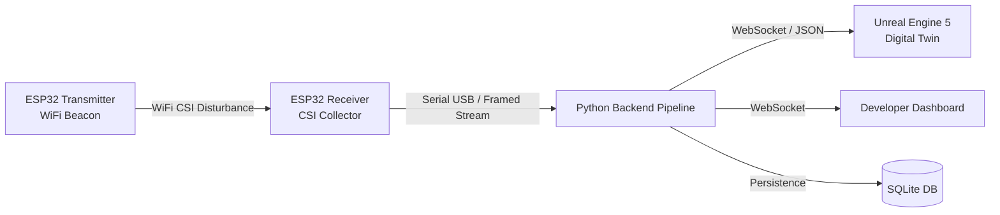

# WiSense-Twin

WiSense-Twin is a device-free human sensing system that uses WiFi Channel State Information (CSI) to detect motion and classify spatial zone presence in real time, visualizing the physical state within an Unreal Engine 5 digital twin. The system runs fully locally without cloud or internet dependencies.

---

## 🏗️ System Architecture



### Core Components
1. **ESP32 Firmware (`esp32_firmware/`)**:
   - `tx_beacon`: ESP32 transmitter broadcasting regular frames.
   - `rx_csi_collector`: ESP32 receiver collecting Channel State Information (CSI) subcarrier amplitudes.
2. **Python Processing Pipeline (`backend_pipeline/`)**:
   - **Ingestion**: Framing, parsing, and stream ingestion (supports both live serial and synthetic generation).
   - **Preprocessing**: Hampel outlier filtering and moving average smoothing.
   - **Feature Extraction**: Sliding window variance extraction across subcarriers.
   - **Motion Detection & Zone Classification**: Adaptive thresholding and nearest-signature spatial classification.
   - **Communication & Storage**: Real-time WebSocket server and local SQLite audit logging.
3. **Developer Dashboard (`dashboard/`)**:
   - Web-based live telemetry and diagnostic visualizer.
4. **Digital Twin (UE5)**:
   - 3D visual representation synchronized via WebSockets.

---

## 📁 Repository Structure

```text
WiSense-Twin/
├── backend_pipeline/        # Python CSI processing engine
│   ├── config/              # Configuration files (motion, preprocessing, zones, etc.)
│   ├── src/wisense_backend/ # Core backend library
│   ├── tests/               # Pytest test suite
│   ├── main.py              # Application entry point
│   └── run_synthetic.py     # Standalone synthetic simulation runner
├── dashboard/               # Lightweight HTML5/JS developer dashboard
├── docs/                    # Hardware integration & developer documentation
├── esp32_firmware/          # ESP-IDF firmware projects
│   ├── rx_csi_collector/    # CSI receiver firmware
│   └── tx_beacon/           # Transmitter firmware
├── scripts/                 # Utility and demonstration scripts
├── PROJECT_OVERVIEW.md      # Project roadmap and architecture constraints
└── PROJECT_HANDOFF.md       # Context and implementation progress
```

---

## 🚀 Quick Start (Synthetic Mode)

You can run and test the complete software pipeline without hardware using the built-in synthetic CSI generator:

### 1. Prerequisites
- Python 3.10+
- Modern Web Browser (for Dashboard)

### 2. Setup Backend
```bash
cd backend_pipeline
pip install -r requirements.txt
```

### 3. Run Backend Pipeline
```bash
python run_synthetic.py
```
This starts the backend, generates synthetic CSI streams, runs signal processing, and broadcasts state messages over WebSockets at `ws://127.0.0.1:8765`.

### 4. Open Developer Dashboard
Open `dashboard/index.html` in your browser to view real-time motion, zone states, and signal metrics.

### 5. Run Test Suite
```bash
cd backend_pipeline
pytest
```

---

## 🛠️ Hardware Setup

For physical ESP32 deployment:
- Requires ESP-IDF (v5.x).
- Refer to [docs/hardware/transmitter-firmware.md](docs/hardware/transmitter-firmware.md) and [docs/hardware/receiver-firmware.md](docs/hardware/receiver-firmware.md).

---

## 📜 License
Academic / Educational Project.
