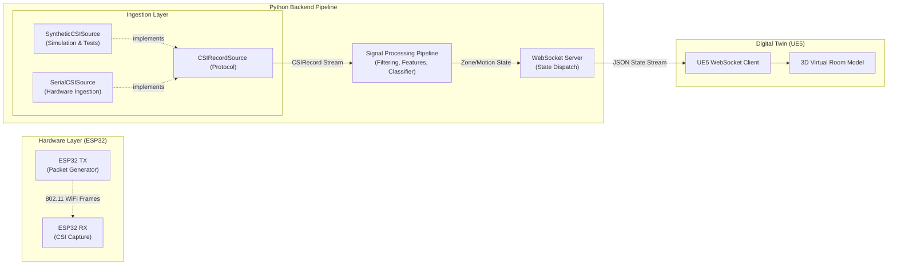
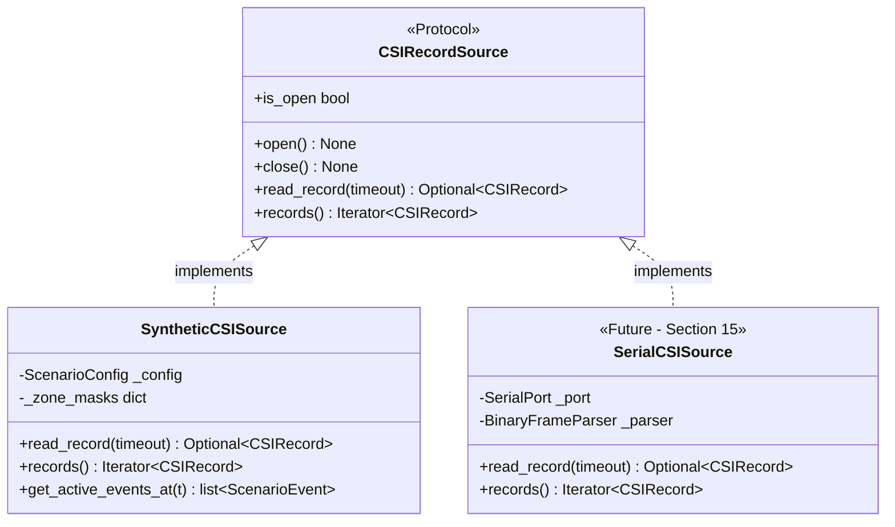

# WiSense-Twin — System Architecture

## 1. System Context & Overview

WiSense-Twin is a device-free indoor human sensing and digital twin visualization platform. It captures WiFi Channel State Information (CSI) disturbance patterns generated by human movement, translates these raw RF variations into real-time spatial motion and zone occupancy states, and visualizes room activity live within an Unreal Engine 5 (UE5) 3D environment.

The system runs entirely locally on edge hardware with zero external cloud dependencies.



---

## 2. Ingestion Layer Architecture

The foundation of the backend is the ingestion layer, defined in `src/wisense_backend/contracts/csi_source.py`.

### 2.1 The `CSIRecord` Contract
The canonical data representation across the entire pipeline is `CSIRecord`, an immutable, frozen dataclass:

```python
@dataclass(frozen=True, slots=True)
class CSIRecord:
    timestamp: float
    subcarrier_count: int
    amplitudes: tuple[float, ...]
    phases: Optional[tuple[float, ...]] = None
    rssi: Optional[float] = None
    channel: Optional[int] = None
    sequence_number: Optional[int] = None
```

#### Invariant Principles:
1. **Zero Ground-Truth Leakage**: `CSIRecord` contains no labels, scenario events, or zone indicators. Downstream consumers (filtering, feature extractors, classifiers) process synthetic frames identically to physical hardware frames.
2. **Amplitude as Primary Feature**: In accordance with system constraints, subcarrier `amplitudes` are mandatory and primary. Phase information (`phases`) is optional and nullable, preventing experimental phase unwrapping from blocking the core pipeline.
3. **Immutability & Safety**: Frozen instances prevent accidental mutation across parallel processing workers or event loops.
4. **Strict UTC Unix Epoch Timestamps**: `timestamp` is strictly a UTC Unix epoch timestamp in seconds (float, e.g. `time.time()`). Real serial hardware readers timestamp frames on arrival using `time.time()`, and synthetic generators must strictly match that convention rather than relative offsets or ad-hoc clocks.

### 2.2 The `CSIRecordSource` Interface
The pipeline abstracts frame acquisition behind the `CSIRecordSource` protocol:

- `open() -> None`: Initializes communication, timers, or file handles.
- `close() -> None`: Gracefully releases system resources.
- `is_open -> bool`: Readiness state.
- `read_record(timeout: Optional[float] = None) -> Optional[CSIRecord]`: Pulls a single frame; supports blocking, timeouts, or non-blocking polling.
- `records() -> Iterator[CSIRecord]`: Continuous streaming iterator.
- `__enter__()` / `__exit__()`: Context management for safe deterministic resource cleanup.



---

## 3. Data Flow & Signal Processing Roadmap

Once a `CSIRecord` leaves the ingestion source, it moves through the pipeline components:

1. **Ingestion (Sections 1 & 15)**: Produces uniform `CSIRecord` frames from `SyntheticCSISource` or real `SerialCSISource`.
2. **Preprocessing (Section 4)**: Outlier rejection (Hampel filtering), low-pass smoothing (Butterworth / moving average), and noise attenuation.
3. **Feature Extraction (Section 5)**: Sliding-window subcarrier variance, Doppler energy estimation, and subcarrier correlation matrices.
4. **Motion Detection (Section 6)**: Dynamic variance thresholding with configurable occupancy timeouts (no stationary presence claims).
5. **Zone Classification (Section 8)**: Evaluates extracted subcarrier energy distribution against calibrated zone spatial profiles (Section 7) to identify active zone $z \in \{1, \dots, N\}$.
6. **Logging & Streaming (Sections 9 & 10)**: SQLite persistence of features and WebSocket broadcast of occupancy events to Unreal Engine 5.

---

## 4. Architectural Constraints & Compliance

Every architectural component in WiSense-Twin strictly complies with the system audit guidelines:

| Constraint | Design Implementation |
|---|---|
| **$N$ Zones (Not Hardcoded)** | `zone_count` is a runtime configuration. Subcarrier spatial weighting dynamically calculates center $c_z = \frac{z - 0.5}{Z} \cdot N_{sc}$ and spread $\sigma_z$, supporting arbitrary room partitions without code changes. |
| **Config-Driven Dimensions** | Subcarrier count ($N_{sc}$), sample rate ($f_s$), and duration are configuration parameters. |
| **Binary Serial Readiness** | The `CSIRecord` schema maps directly to binary UART frame structures (timestamp, subcarrier array, RSSI, sequence count). |
| **Decoupled Swappable Interfaces** | All producers and downstream consumers interact solely via abstract protocols (`CSIRecordSource`), enabling hot-swapping from synthetic simulation to physical ESP32 hardware without modifying downstream code. |
| **Strict UTC Epoch Timestamps** | `timestamp` is strictly UTC Unix epoch seconds (`time.time()`). Real hardware serial readers and synthetic sources share this exact convention. |
| **Timing Agnostic Testing** | Pacing modes (`realtime=True` for wall-clock simulation vs `realtime=False` for instantaneous offline execution) enable deterministic, microsecond-scale unit and regression testing. |
