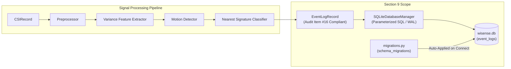
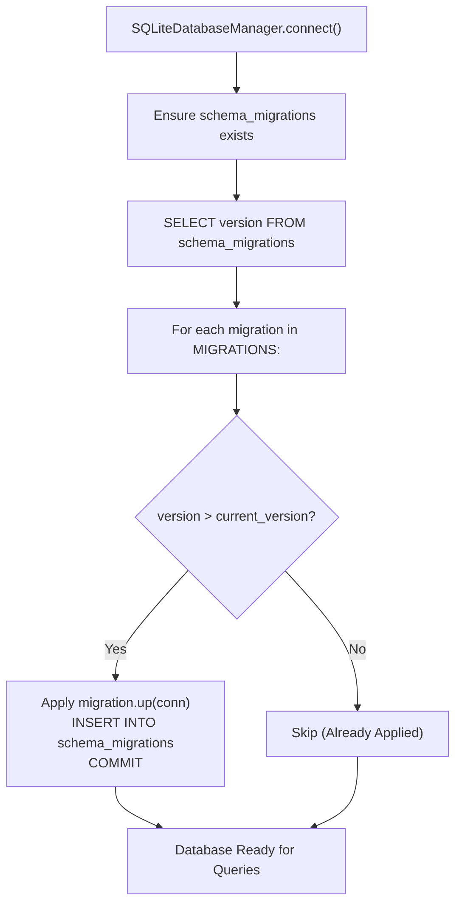

# Database Architecture & Persistence Layer

This document details the SQLite database persistence layer, telemetry event schema (`event_logs`), schema versioning and migrations (`schema_migrations`), latency separation principles, and ground-truth isolation design for the WiSense-Twin backend pipeline.

---

## 1. System Architecture & Scope Isolation

The persistence layer provides an interchangeable, decoupled database backend (`DatabaseManager` protocol) backed by SQLite (`SQLiteDatabaseManager`). It consumes telemetry records produced across the 8-stage pipeline:



> [!IMPORTANT]
> **Explicit Scope Boundary — Runtime Wiring Deferral**:
> In accordance with the Section 9 roadmap requirements:
> - The persistence layer is designed, tested, and validated in isolation against the full pipeline outputs.
> - **Generating `run_id` session identifiers and wiring the database manager into the live `Application.run()` loop (or `main.py`) is explicitly deferred to later integration sections.**
> - Connection health metrics (e.g. dropped packets, frame errors) belong to Section 11 (Health Monitoring), not this event log.

---

## 2. Telemetry Event Schema (`event_logs`)

The `event_logs` table addresses every gap identified in the architecture feasibility audit (Audit Item #16), providing complete provenance and diagnostic tracing for every analysis window:

```sql
CREATE TABLE IF NOT EXISTS event_logs (
    id INTEGER PRIMARY KEY AUTOINCREMENT,
    run_id TEXT NOT NULL,
    event_timestamp REAL NOT NULL,
    window_start_timestamp REAL NOT NULL,
    window_end_timestamp REAL NOT NULL,
    sample_count INTEGER NOT NULL,
    is_motion INTEGER NOT NULL,
    presence INTEGER NOT NULL,
    zone_id INTEGER,
    separation_margin REAL,
    calibration_version INTEGER,
    aggregate_variance REAL NOT NULL,
    window_latency_ms REAL NOT NULL,
    pipeline_latency_ms REAL,
    ground_truth_zone INTEGER,
    ground_truth_motion INTEGER,
    created_at TEXT NOT NULL DEFAULT (strftime('%Y-%m-%dT%H:%M:%fZ', 'now'))
);

CREATE INDEX IF NOT EXISTS idx_event_logs_run_id ON event_logs(run_id);
CREATE INDEX IF NOT EXISTS idx_event_logs_timestamp ON event_logs(event_timestamp);
```

### 2.1 Column Field Definitions

| Column | Type | Nullable | Description |
|---|---|---|---|
| `id` | `INTEGER` | No | Auto-incrementing primary key. |
| `run_id` | `TEXT` | No | Caller-supplied session identifier grouping events from one continuous execution. |
| `event_timestamp` | `REAL` | No | UTC Unix epoch seconds when the decision was published. |
| `window_start_timestamp` | `REAL` | No | UTC Unix epoch seconds of earliest frame in the analysis window. |
| `window_end_timestamp` | `REAL` | No | UTC Unix epoch seconds of latest frame in the analysis window. |
| `sample_count` | `INTEGER` | No | Actual number of CSI frames contributing to this window calculation. |
| `is_motion` | `INTEGER` | No | Instantaneous hysteresis motion decision (1 = motion, 0 = quiet). |
| `presence` | `INTEGER` | No | Motion-derived presence flag sustained by timeout (1 = present, 0 = absent). |
| `zone_id` | `INTEGER` | Yes | 1-indexed room zone ID, or `NULL` if no motion or ambiguous margin. |
| `separation_margin` | `REAL` | Yes | Distance gap between winning zone and runner-up ($d_2 - d_1$). Never called confidence. |
| `calibration_version` | `INTEGER` | Yes | Integer version of the active `CalibrationProfile` used for classification. |
| `aggregate_variance` | `REAL` | No | Scalar variance energy that drove the motion detection decision. |
| `window_latency_ms` | `REAL` | No | Known, config-derived physical window fill delay ($W / f_s \times 1000$ ms). |
| `pipeline_latency_ms` | `REAL` | Yes | Measured wall-clock computational latency (ms). Strictly `NULL` for synthetic batch runs. |
| `ground_truth_zone` | `INTEGER` | Yes | Ground-truth zone ID for labeled validation (Section 23). `NULL` in online operation. |
| `ground_truth_motion` | `INTEGER` | Yes | Ground-truth motion boolean for labeled validation. `NULL` in online operation. |
| `created_at` | `TEXT` | No | UTC ISO 8601 database insertion timestamp. |

---

## 3. Physical Latency Separation (Audit Item #14)

> [!CAUTION]
> **Audit Item #14 — Never Conflate Physical Buffering Delay with Execution Latency**:
> 
> System latency consists of two physically distinct components with completely different origins:
> 
> 1. **`window_latency_ms` (Physical Buffering Floor)**:
>    $$\text{window\_latency\_ms} = \frac{W}{f_s} \times 1000 \text{ ms}$$
>    This is an immutable physical delay imposed by the sliding analysis window (e.g. 20 samples at 20 Hz = 1000.0 ms). It is derived directly from configuration, not measured with a stopwatch. Downstream components physically cannot observe events faster than this window duration.
> 
> 2. **`pipeline_latency_ms` (Wall-Clock Computational Latency)**:
>    $$\text{pipeline\_latency\_ms} = (t_{\text{persisted}} - t_{\text{record\_arrival}}) \times 1000 \text{ ms}$$
>    This represents the real-time processing and inference overhead of the Python backend.
> 
> **Batch Run Rule**:
> When running non-realtime synthetic batch processing (e.g. generating 300 frames in 50 milliseconds without realtime clock pauses), calculating wall-clock execution time produces meaningless artifacts. Therefore, **`pipeline_latency_ms` is strictly `NULL` during non-realtime batch execution** and is only populated when running against a realtime or physical serial hardware source.

---

## 4. Separation Margin vs. Fabricated Confidence (Audit Item #13)

Per the architecture audit, the field `separation_margin` records:
$$\Delta = d_{(2)} - d_{(1)} \ge 0$$
- It represents the physical dissimilarity gap between the closest reference signature and its nearest competitor.
- It is **never called or mapped to "confidence"**.
- Storing unvalidated confidence scores in a telemetry database corrupts longitudinal analytics and creates a false sense of spatial certainty.

---

## 5. Ground-Truth Isolation in Telemetry

To preserve strict ground-truth isolation:
- The online pipeline (`CSIRecord` $\to$ `PreprocessingPipeline` $\to$ `VarianceFeatureExtractor` $\to$ `ThresholdMotionDetector` $\to$ `NearestSignatureZoneClassifier`) remains completely blind to ground truth.
- `ground_truth_zone` and `ground_truth_motion` are nullable columns in `event_logs`.
- During normal online runtime operation, they are written as `NULL`.
- They exist solely so future experimental validation tooling (Section 23: accuracy, confusion matrices) can supply known ground truth when running labeled evaluation sessions, without requiring a secondary or divergent database schema.

---

## 6. Schema Migrations Mechanism

Per Project Coding Standard #28 ("make database migrations possible"), database schema changes are managed via `migrations.py`:



### 6.1 `schema_migrations` Table
```sql
CREATE TABLE IF NOT EXISTS schema_migrations (
    version INTEGER PRIMARY KEY,
    applied_at TEXT NOT NULL,
    description TEXT NOT NULL
);
```

### 6.2 Idempotency & Extensibility
- **Idempotent**: Calling `apply_migrations()` on an already-migrated database executes zero DDL and returns immediately.
- **Adding Future Migrations**: When a future section requires schema modifications (e.g. Section 11 adding a health log table):
  1. Define a migration function: `_migration_0002_add_health_table(conn)`.
  2. Append `Migration(version=2, description="...", up=...)` to `MIGRATIONS`.
  3. Existing databases automatically upgrade on the next `connect()` call without manual administrative intervention.
