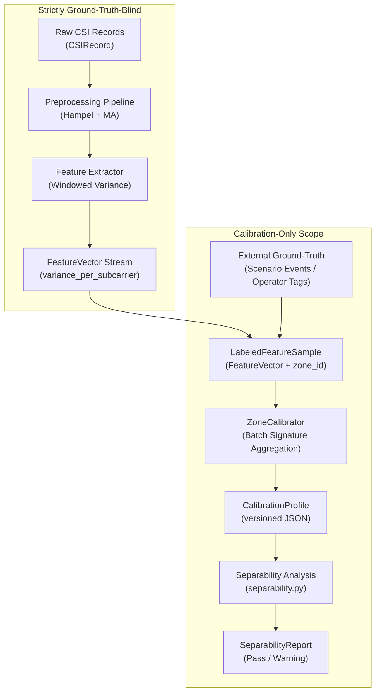

# Zone Calibration & Separability Methodology

This document details the offline zone calibration architecture, mathematical formulation of `ZoneSignature`, pairwise separability metrics, calibration profile serialization schema, and the physical interpretation of calibration reports for the WiSense-Twin platform.

---

## 1. System Feasibility Audit & Physical Realism Disclaimer

> [!WARNING]
> **Audit Item #10 — Operationalization & Physical Realism Limitation**:
> 
> **Separability results derived from synthetic data demonstrate the correctness of the computational mechanism, NOT that physical ESP32 transceivers will discriminate spatial zones identically in real hardware.**
> 
> In synthetic simulation, each zone is modeled by a synthetic spatial sensitivity mask (Gaussian perturbation across subcarrier frequency bins). In physical indoor environments:
> - RF multipath reflections depend on wall materials, furniture clutter, room geometry, and dynamic scattering.
> - Subcarrier perturbations from human motion are complex, non-linear, and distributed across subcarriers without neat frequency isolation.
> - Two adjacent zones separated by only 1–2 meters in a small room may induce nearly identical multipath channel changes at a single transceiver link.
> 
> The purpose of `separability.py` is to turn this physical risk from an unverified assumption into an **empirical measurement**. If calibration data for two zones yields low separability, the system warns operators before deployment rather than generating erratic zone classifications at runtime.

---

## 2. Calibration Pipeline Architecture

Calibration is an **offline, batch process**. It derives reference signatures from labeled recordings of confirmed human motion within designated physical zones.



### Ground-Truth Isolation Principle
The online runtime pipeline (`CSIRecord` $\to$ `PreprocessingPipeline` $\to$ `VarianceFeatureExtractor` $\to$ `ThresholdMotionDetector`) is strictly **ground-truth-blind**. Under no circumstances is a `zone_id` or physical room label introduced into `FeatureVector` or any pipeline contract. 

Offline labeling is encapsulated entirely within `LabeledFeatureSample`, ensuring the runtime system retains full parity with real, unlabeled hardware transmissions.

---

## 3. Mathematical Formulations

### 3.1 Zone Signature (`ZoneSignature`)
Let a calibration session for zone $z \in \{1, \dots, N\}$ contain $M_z$ labeled feature vectors:
$$\mathcal{S}_z = \left\{ \mathbf{v}_1^{(z)}, \mathbf{v}_2^{(z)}, \dots, \mathbf{v}_{M_z}^{(z)} \right\}$$
where each $\mathbf{v}_i^{(z)} \in \mathbb{R}_{\ge 0}^K$ is the per-subcarrier variance vector over $K$ OFDM subcarriers.

The reference `ZoneSignature` for zone $z$ is the element-wise empirical mean:
$$\bar{v}_{z, k} = \frac{1}{M_z} \sum_{i=1}^{M_z} v_{i, k}^{(z)}, \quad \forall k \in \{1, \dots, K\}$$

The mean aggregate energy is similarly derived:
$$\bar{A}_z = \frac{1}{M_z} \sum_{i=1}^{M_z} A_i^{(z)}$$

### 3.2 Pairwise Zone Separability (Cosine Distance)
To measure whether Zone $a$ and Zone $b$ produce distinguishable RF perturbations, we compute the **Cosine Distance** between their reference variance vectors $\bar{\mathbf{v}}_a$ and $\bar{\mathbf{v}}_b$:

$$d_{\text{cos}}(\bar{\mathbf{v}}_a, \bar{\mathbf{v}}_b) = 1.0 - \frac{\bar{\mathbf{v}}_a \cdot \bar{\mathbf{v}}_b}{\|\bar{\mathbf{v}}_a\|_2 \|\bar{\mathbf{v}}_b\|_2}$$

#### Why Cosine Distance?
1. **Scale Invariance**: Human walking speed or movement vigor changes absolute variance magnitude ($\|\bar{\mathbf{v}}\|_2$). Cosine distance normalizes by vector length, comparing only the **spatial shape and relative subcarrier perturbation profile** of the zone.
2. **Bounded Metric**: Because CSI variances are strictly non-negative ($v_k \ge 0$), the cosine similarity is bounded in $[0.0, 1.0]$, yielding a clean distance metric in $[0.0, 1.0]$:
   - $d_{\text{cos}} = 0.0$: Identical spectral distribution; zones are completely indistinguishable.
   - $d_{\text{cos}} = 1.0$: Perfectly orthogonal subcarrier activation; zones are maximally distinct.

---

## 4. Separability Evaluation & Interpretation

The `compute_separability()` engine computes $d_{\text{cos}}$ across all $\binom{N}{2}$ unique zone pairs and evaluates them against a configurable threshold $\tau$ (default $\tau = 0.20$):

```
Pairwise Metric: Zone a vs Zone b
      0.0 ─────────────────────── τ (0.20) ─────────────────────── 1.0
             POORLY-SEPARATED                 WELL-SEPARATED
        (Severe Spatial Ambiguity)         (Adequate Discrimination)
```

### Diagnostic Report Format
When evaluated, `SeparabilityReport.summary()` outputs a standardized diagnostic table:

```
====================================================================
ZONE SEPARABILITY REPORT (Profile Version 1)
Zones: 4 | Metric: cosine_distance | Threshold: 0.20
--------------------------------------------------------------------
Pair         | Score      | Status           | Separable?
--------------------------------------------------------------------
Zone 1 - 2   | 0.4558     | WELL-SEPARATED   | YES       
Zone 1 - 3   | 0.7216     | WELL-SEPARATED   | YES       
Zone 1 - 4   | 0.7420     | WELL-SEPARATED   | YES       
Zone 2 - 3   | 0.4615     | WELL-SEPARATED   | YES       
Zone 2 - 4   | 0.7213     | WELL-SEPARATED   | YES       
Zone 3 - 4   | 0.4521     | WELL-SEPARATED   | YES       
--------------------------------------------------------------------
OVERALL VERDICT: PASS -- All zone pairs meet the separability threshold.
====================================================================
```

### 4.1 Metric and Threshold Coupling (Non-Interchangeability)

> [!IMPORTANT]
> **Threshold and Metric Coupling**:
> The separability `threshold` is **not directly comparable across different metric choices**. A threshold calibrated for `cosine_distance` does not represent the same discriminative strictness under `normalized_euclidean`.
> 
> Mathematically, normalized Euclidean distance relates to cosine distance by:
> $$d_{\text{norm}}(\bar{\mathbf{v}}_a, \bar{\mathbf{v}}_b) = \sqrt{d_{\text{cos}}(\bar{\mathbf{v}}_a, \bar{\mathbf{v}}_b)}$$
> 
> Because the square root function is strictly concave and expands values between 0 and 1:
> - A zone pair with a weak cosine distance of $d_{\text{cos}} = 0.05$ produces $d_{\text{norm}} = \sqrt{0.05} \approx 0.224$.
> - If an operator keeps the default threshold $\tau = 0.20$ but switches `metric` from `cosine_distance` to `normalized_euclidean`, this poorly-separated pair will **falsely pass** the threshold ($0.224 \ge 0.20$), masking severe spatial ambiguity!
> - Conversely, achieving $d_{\text{norm}} \ge 0.50$ requires $d_{\text{cos}} \ge 0.25$.
> 
> **Rule for Operators**: Treat `(metric, threshold)` as an **independently calibrated pair**. Never change the distance metric without re-evaluating and tuning the threshold appropriately.

### 4.2 Remediating Poorly-Separated Zones
If two zones fail the separability threshold (`is_separated = False`):
1. **Physical Layout Adjustment**: Reposition the ESP32 transmitter and receiver antennas to alter the line-of-sight and multipath reflection geometry relative to the problem zones.
2. **Zone Consolidation**: If two zones are physically contiguous and cannot be differentiated by a single RF link, merge them into a single larger zone.
3. **Multi-Link Expansion**: Add a secondary receiver node (future scope) to provide multi-angle RF sensing.

---

## 5. Calibration Profile Schema & Persistence

Calibration profiles are stored as immutable, versioned JSON files under `backend_pipeline/config/calibration_profiles/`.

### JSON Profile Schema
```json
{
  "zone_count": 4,
  "subcarrier_count": 64,
  "calibration_version": 1,
  "created_at": "2026-09-15T00:00:00+00:00",
  "source": "synthetic",
  "zone_signatures": {
    "1": {
      "zone_id": 1,
      "subcarrier_count": 64,
      "mean_variance_per_subcarrier": [0.052, 0.081, 0.354, "..."],
      "mean_aggregate_variance": 12.45,
      "sample_count": 50
    },
    "2": { ... },
    "3": { ... },
    "4": { ... }
  }
}
```

### Versioning Rules
- `calibration_version` starts at `1` and monotonically increments with each recalibration session.
- Upstream consumers (Section 8 Zone Classifier) record the active `calibration_version` to maintain complete provenance of classification decisions in telemetry logs.
