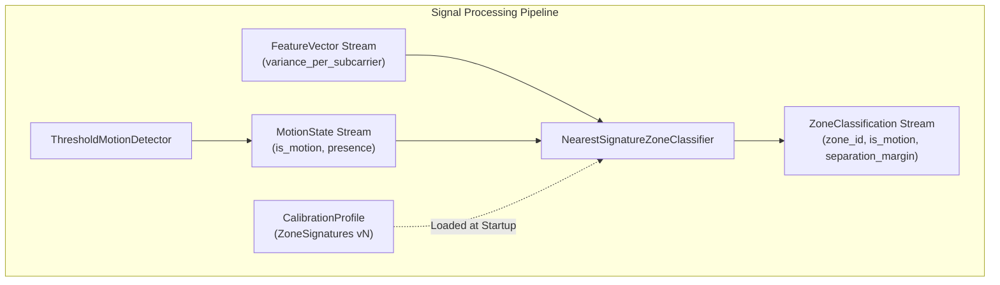

# Spatial Zone Classification Strategy

This document details the motion-gated spatial classification architecture, nearest reference signature matching algorithm, separation margin diagnostic quantity, startup separability health checks, and configuration schema for the WiSense-Twin backend pipeline.

---

## 1. System Architecture & Motion-Gated Pipeline

Zone classification operates downstream of both Feature Extraction (Section 5) and Motion Detection (Section 6), consuming pre-calibrated reference signatures from a loaded `CalibrationProfile` (Section 7):



### 1.1 Strict Motion Gating
> [!CAUTION]
> **Audit Item #10 & #13 Compliance — Zero Spatial Fabrication From Noise**:
> 
> Under quiet conditions (`is_motion = False`), Channel State Information (CSI) variance hovers near the thermal noise floor ($\sigma_v^2 \approx 0$). In this regime:
> - Any subtle subcarrier fluctuations are driven by receiver noise or ambient multipath drift, not human spatial presence.
> - Attempting to classify a spatial zone from background noise is mathematically guaranteed to generate spurious, arbitrary room locations.
> 
> **Design Rule**:
> When `is_motion = False`, the classifier **short-circuits immediately** and reports an explicit unknown state:
> $$\text{zone\_id} = \text{None}, \quad \text{separation\_margin} = \text{None}$$
> The classifier never guesses, never defaults to Zone 1, and never carries over stale zone IDs.

---

## 2. The Two Independent Paths to an "Unknown" Result

A `ZoneClassification` can legitimately report `zone_id = None` through two completely independent and mutually exclusive mechanisms:

```
                                  [ Input Window ]
                                         │
                             Is is_motion == True?
                                  /             \
                             No  /               \ Yes
                                ▼                 ▼
                      [ PATH 1: GATED ]      Compare FeatureVector against
                      No physical motion     calibrated ZoneSignatures:
                      detected in room.      Compute best (d1) & 2nd-best (d2)
                                │                 │
                                │            Is Margin (d2 - d1) >= min_margin?
                                │                 /             \
                                │            No  /               \ Yes
                                │               ▼                 ▼
                                │     [ PATH 2: AMBIGUOUS ]   [ ASSIGNED ]
                                │     Motion active, but      Confident winner:
                                │     match is equivocal.     zone_id = best_zone
                                │               │                 │
                                └───────┬───────┘                 │
                                        ▼                         ▼
                                 zone_id = None             zone_id = z
```

| Path | Condition | `is_motion` | `zone_id` | `separation_margin` | Physical Meaning |
|---|---|---|---|---|---|
| **Path 1: Motion Gate** | Background quiet | `False` | `None` | `None` | The room is quiet; no physical RF disturbance exists to localize. |
| **Path 2: Ambiguous Margin** | Multi-zone overlap | `True` | `None` | $\Delta < \tau_{\text{margin}}$ | Motion is actively occurring, but the RF perturbation matches two or more zones almost equally; guessing would be unreliable. |
| **Path 3: Resolved Match** | Dominant winner | `True` | $z \in [1, N]$ | $\Delta \ge \tau_{\text{margin}}$ | Motion is active and the spectral signature distinctly favors zone $z$. |

---

## 3. Nearest Signature Matching Algorithm

When `is_motion = True`, classification proceeds through the following deterministic steps:

### 3.1 Pairwise Distance Evaluation
The incoming `FeatureVector.variance_per_subcarrier` ($\mathbf{v} \in \mathbb{R}^K$) is compared against each reference `ZoneSignature` ($\bar{\mathbf{v}}_z \in \mathbb{R}^K$) in the loaded `CalibrationProfile`:

$$d_z = \mathcal{D}(\mathbf{v}, \bar{\mathbf{v}}_z), \quad \forall z \in \{1, \dots, N\}$$

where $\mathcal{D}$ is the configured distance metric from Section 7 (default: `compute_cosine_distance`):
$$d_{\text{cos}}(\mathbf{v}, \bar{\mathbf{v}}_z) = 1.0 - \frac{\mathbf{v} \cdot \bar{\mathbf{v}}_z}{\|\mathbf{v}\|_2 \|\bar{\mathbf{v}}_z\|_2}$$

### 3.2 Candidate Ranking
The candidate zones are sorted in ascending order of distance:
$$(z_{(1)}, d_{(1)}), (z_{(2)}, d_{(2)}), \dots, (z_{(N)}, d_{(N)})$$
where $d_{(1)} \le d_{(2)} \le \dots \le d_{(N)}$. The winning candidate is $z^* = z_{(1)}$.

---

## 4. Separation Margin vs. Fabricated "Confidence"

> [!IMPORTANT]
> **Audit Item #13 Discipline — Separation Margin is NOT Confidence**:
> 
> The field `separation_margin` measures the distance gap between the best and second-best candidate:
> $$\Delta = d_{(2)} - d_{(1)} \ge 0$$
> 
> - **Defined Physical Quantity**: $\Delta$ indicates how much more closely the observed feature matched the winning signature compared to its nearest competitor.
> - **Never Called "Confidence"**: A high margin means the RF shape was distinct from other zones; it is **NOT** a statistically validated probability (e.g. "95% sure"). Fabricating artificial confidence scores from heuristic distances misleads downstream digital twin renderers and operators.

### 4.1 Ambiguity Thresholding
If the user configures `min_separation_margin` ($\tau_{\text{margin}} > 0$):
$$\text{zone\_id} = \begin{cases} z_{(1)} & \text{if } \Delta \ge \tau_{\text{margin}} \\ \text{None} & \text{if } \Delta < \tau_{\text{margin}} \text{ (Path 2: Ambiguity)} \end{cases}$$

---

## 5. Startup Separability Audit

At constructor time, `NearestSignatureZoneClassifier` executes `compute_separability()` against the loaded profile:

```python
report = compute_separability(profile, threshold=config.separability_warning_threshold, metric=config.metric)
if not report.is_fully_separable:
    logger.warning("Loaded CalibrationProfile v%d contains %d poorly-separated zone pair(s)...", ...)
```

- **Runtime Payoff of Section 7**: Ensures that spatial ambiguities documented in the calibration profile surface immediately in application startup logs.
- **Resilient Execution**: The classifier logs a clear warning identifying the conflicting pairs, but does not abort execution, allowing operational testing to proceed while alerting developers to the hardware or placement issue.

---

## 6. Configuration Schema

Configured via `backend_pipeline/config/zone_classification_config.json`:

```json
{
  "metric": "cosine_distance",
  "min_separation_margin": 0.05,
  "separability_warning_threshold": 0.20
}
```

| Parameter | Type | Default | Description |
|---|---|---|---|
| `metric` | `str` | `"cosine_distance"` | Dissimilarity metric (`cosine_distance` or `normalized_euclidean`). |
| `min_separation_margin` | `float \| null` | `0.05` | Minimum $\Delta$ required to assign a zone. Below this, `zone_id=None` is returned. |
| `separability_warning_threshold` | `float` | `0.20` | Threshold used to audit the loaded profile at startup and warn of poorly-separated zone pairs. |
