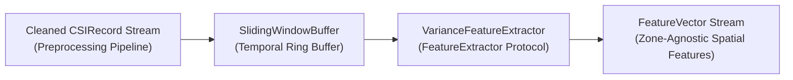

# Feature Engineering & Spatial Energy Representation

This document details the feature extraction architecture, mathematical formulation, configuration schema, windowing behavior, and system latency budget for the WiSense-Twin backend pipeline.

---

## 1. Architectural Role & Design Principles

The feature extraction layer transforms a cleaned temporal sequence of `CSIRecord` frames (from the preprocessing pipeline in Section 4) into a continuous stream of `FeatureVector` snapshots.



### Key Principles:
1. **Ground-Truth Isolation**: `FeatureVector` contains **zero** zone identifiers, occupancy tags, or motion classification flags. Mapping subcarrier energy profiles to physical room zones is the exclusive responsibility of downstream zone classification (Section 8).
2. **Scope Discipline (MVP Variance Baseline)**: In accordance with the system audit and software requirements, **windowed per-subcarrier variance is the sole baseline feature** implemented. Complex spectral/Doppler frequency-domain features are deferred as stretch goals if empirical calibration (Section 7) proves variance insufficient.
3. **Interchangeable Extractor Interface**: All extractors implement the `FeatureExtractor` protocol (`src/wisense_backend/contracts/feature_extractor.py`), ensuring future feature extraction strategies can drop in without downstream refactoring.

---

## 2. Detection Latency Budget & Audit Item #14

> [!IMPORTANT]
> **Audit Item #14 — Physical Detection Latency Floor**:
> The temporal buffering performed in `SlidingWindowBuffer` is the **direct physical site of the detection latency floor** identified in the architecture feasibility audit.

For sample rate $f_s$ (Hertz) and analysis window size $W$ (samples):

$$\text{Latency}_{\text{floor}} = \frac{W}{f_s}$$

For example, at the baseline rate $f_s = 20\text{ Hz}$ and window size $W = 20\text{ samples}$:

$$\text{Latency}_{\text{floor}} = \frac{20}{20\text{ Hz}} = 1.0\text{ second}$$

### Consequences for Downstream Modules:
- **Startup Lag**: No motion detection or zone classification can occur during the first $1.0\text{ second}$ after stream startup or reset while the window accumulates frames.
- **Reaction Time**: An abrupt human motion event cannot be reflected in the feature vector until sufficient disturbed frames enter the trailing window.
- **Update Interval**: Once the buffer fills, new feature vectors are emitted every $S / f_s$ seconds (where $S$ is `window_step_samples`). For continuous sliding ($S = 1$), updates arrive every $50\text{ ms}$ ($20\text{ Hz}$).

---

## 3. Partial-Window Policy Decision

The `SlidingWindowBuffer` supports a configurable partial-window policy (`emit_partial: bool`):

- **Default Choice (`emit_partial = false`)**: **Emit nothing until the buffer is full ($N = W$).**
  - *Mathematical Rationale*: The sample variance estimator $s^2 = \frac{1}{N-1}\sum_{i=1}^N (x_i - \bar{x})^2$ has variance proportional to $\frac{2\sigma^4}{N-1}$. Computing variance over small sample sizes ($N < 5$) yields noisy, erratic estimates that trigger spurious false alarms in downstream motion detectors. Holding emission until $N = W$ guarantees stable statistical variance.
- **Alternative (`emit_partial = true`)**: Emits growing partial windows ($1 \le k < W$) for low-latency diagnostic modes where early noisy estimates are acceptable.

---

## 4. Mathematical Formulation

For an analysis window $X \in \mathbb{R}^{W \times N_{sc}}$ of $W$ frames across $N_{sc}$ OFDM subcarriers:

### 4.1 Per-Subcarrier Variance
For each subcarrier $j \in \{1, \dots, N_{sc}\}$:

$$\bar{x}_j = \frac{1}{W} \sum_{i=1}^W x_{i, j}$$

$$\text{Var}_j = \frac{1}{W - \text{ddof}} \sum_{i=1}^W (x_{i, j} - \bar{x}_j)^2$$

where $\text{ddof} = 1$ yields the unbiased sample variance ($s^2$).

### 4.2 Aggregate Spatial Variance
The overall RF disturbance in the monitored space is summarized by the scalar aggregate variance across all subcarriers:

$$\bar{V}_{\text{agg}} = \frac{1}{N_{sc}} \sum_{j=1}^{N_{sc}} \text{Var}_j$$

Quiet environments exhibit baseline thermal noise variance ($\bar{V}_{\text{agg}} \approx \sigma_{\text{noise}}^2$). Human physical displacement introduces multipath interference that sharply elevates variance in the subcarriers matching the disturbed spatial zone.

---

## 5. Schema Reference

### 5.1 `FeatureVector` Data Class
Defined in `contracts/feature_extractor.py`:

| Field | Type | Description |
|---|---|---|
| `window_start_timestamp` | `float` | UTC Unix epoch seconds (`time.time()`) of the first frame in the window. |
| `window_end_timestamp` | `float` | UTC Unix epoch seconds of the latest frame in the window. |
| `sample_count` | `int` | Number of contributing CSI records ($W$). |
| `subcarrier_count` | `int` | Number of analyzed OFDM subcarriers ($N_{sc}$). |
| `variance_per_subcarrier` | `tuple[float, ...]` | Length-$N_{sc}$ tuple of individual subcarrier variances. |
| `aggregate_variance` | `float` | Mean variance across all subcarriers. |

### 5.2 Configuration Schema (`feature_extraction_config.json`)

```json
{
  "extractor_type": "variance",
  "window_size_samples": 20,
  "window_step_samples": 1,
  "emit_partial": false,
  "ddof": 1
}
```

| Parameter | Type | Default | Constraints | Description |
|---|---|---|---|---|
| `extractor_type` | `string` | `"variance"` | `"variance"` | Extractor algorithm identifier. |
| `window_size_samples` | `integer` | `20` | $\ge 2$ | Number of frames per analysis window. |
| `window_step_samples` | `integer` | `1` | $\ge 1$ | Stride between consecutive window evaluations ($1$ = continuous sliding). |
| `emit_partial` | `boolean` | `false` | `true \| false` | Whether to emit partial windows before buffer fills. |
| `ddof` | `integer` | `1` | $\ge 0$ | Delta degrees of freedom for variance computation ($1$ = sample variance). |
