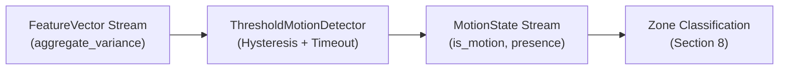

# Motion Detection & Presence Tracking

This document details the motion detection architecture, dual-threshold hysteresis mechanism, motion-derived presence heuristic, and configuration schema for the WiSense-Twin backend pipeline.

---

## 1. Core Principle: Motion vs. Occupancy

> [!CAUTION]
> **System Feasibility Audit Finding — Motion vs. Occupancy**:
> This sensing system detects **physical human motion**, NOT **static human occupancy**.
> 
> A stationary person (e.g. seated, reading, or sleeping) perturbs WiFi Channel State Information (CSI) only through breathing and micro-movements, which are buried beneath environmental multipath and thermal noise in single-antenna commercial edge transceivers.
> 
> Therefore:
> - **`is_motion`** indicates that physical RF disturbance is actively occurring at this instant.
> - **`presence`** indicates that motion was observed within a recent configurable timeout window ($T_{\text{timeout}}$). It is a heuristic proxy ("someone was active here recently"), **never a definitive assertion of physical occupancy**.
> - **Naming Rule**: Attributes and variables are strictly named `is_motion` and `presence`. Under no circumstances is anything named `occupancy` or `is_occupied`, as that misrepresents physical device-free sensing capabilities.

---

## 2. Architecture & Data Flow

Motion detection operates downstream of feature extraction (Section 5) and upstream of zone classification (Section 8):



### Ground-Truth & Spatial Isolation
Motion detection is strictly **zone-agnostic**. It evaluates scalar `aggregate_variance` across all subcarriers to determine whether room disturbance is present. Mapping subcarrier disturbance patterns to specific spatial room zones ($z \in \{1, \dots, N\}$) is exclusively the responsibility of Zone Classification (Section 8).

---

## 3. Algorithmic Formulations

### 3.1 Dual-Threshold Hysteresis Deadband
Single-threshold detectors exhibit rapid on/off state chatter when variance hovers near the threshold value (Audit Item #9). 

The `ThresholdMotionDetector` establishes a stable deadband between two distinct thresholds:
$$T_{\text{enter}} > T_{\text{exit}} > 0$$

```
aggregate_variance
      ▲
      │       [ MOTION DETECTED (is_motion = True) ]
T_enter ─────────────────────────────────────────────── Transition to True
      │          ▲                             │
      │          │     Deadband (No Change)    │
      │          │                             ▼
T_exit  ─────────────────────────────────────────────── Transition to False
      │       [ NO MOTION (is_motion = False) ]
      └──────────────────────────────────────────────────► Time
```

1. **When in No-Motion State (`is_motion = False`)**:
   $$\text{Transition to True if } V_{\text{agg}} > T_{\text{enter}}$$
2. **When in Motion State (`is_motion = True`)**:
   $$\text{Transition to False if } V_{\text{agg}} < T_{\text{exit}}$$
3. **In the Deadband ($T_{\text{exit}} \le V_{\text{agg}} \le T_{\text{enter}}$)**:
   $$\text{Retain previous state (Zero Flicker)}$$

---

### 3.2 Motion-Derived Presence Timeout
To convert intermittent motion spikes (e.g. footsteps, arm gestures) into a stable spatial signal suitable for the Unreal Engine 5 digital twin avatar, the detector sustains the `presence` flag using a post-motion timer:

$$t_{\text{elapsed}} = t_{\text{frame}} - t_{\text{last\_motion}}$$

$$\text{presence} = 
\begin{cases} 
\text{True}, & \text{if } \text{is\_motion} = \text{True} \\ 
\text{True}, & \text{if } \text{is\_motion} = \text{False} \text{ and } t_{\text{elapsed}} \le T_{\text{timeout}} \\ 
\text{False}, & \text{if } \text{is\_motion} = \text{False} \text{ and } t_{\text{elapsed}} > T_{\text{timeout}} 
\end{cases}$$

> [!NOTE]
> **Deterministic Time Tracking**: $t_{\text{frame}}$ is obtained directly from `FeatureVector.window_end_timestamp`. This guarantees 100% deterministic behavior across both real-time wall-clock operations and offline synthetic scenario test suites.

---

## 4. Configuration Schema (`motion_detection_config.json`)

Configuration is loaded from `backend_pipeline/config/motion_detection_config.json`:

```json
{
  "enter_threshold": 0.40,
  "exit_threshold": 0.20,
  "presence_timeout_seconds": 3.0
}
```

### Parameter Reference
| Parameter | Type | Default | Constraints | Description |
|---|---|---|---|---|
| `enter_threshold` | `float` | `0.40` | $> \text{exit\_threshold}$ | Aggregate variance threshold required to activate motion state. |
| `exit_threshold` | `float` | `0.20` | $> 0.0, < \text{enter\_threshold}$ | Aggregate variance threshold below which motion state deactivates. |
| `presence_timeout_seconds` | `float` | `3.0` | $> 0.0$ | Time in seconds to sustain the `presence` flag after the last confirmed motion. |

> [!WARNING]
> **Placeholder Thresholds Notice**:
> The default thresholds ($0.40 / 0.20$) are uncalibrated baseline starting points derived from synthetic data. They **require empirical tuning during Zone Calibration (Section 7)** once real ESP32 hardware data is captured in the physical room environment.
