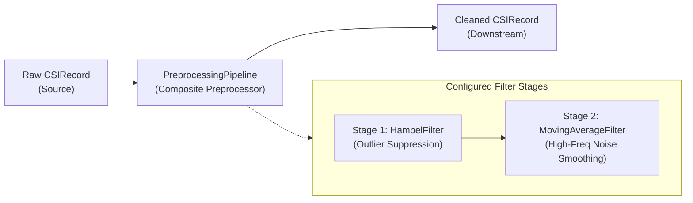

# Signal Preprocessing Pipeline

This document details the preprocessing architecture, filter algorithms, configuration schema, and signal conditioning rationale for the WiSense-Twin backend pipeline.

---

## 1. Architectural Role & Design Principles

Raw WiFi Channel State Information (CSI) acquired from ESP32 hardware (or generated synthetically) contains high-frequency thermal noise and impulsive outlier spikes caused by packet collisions, AGC (Automatic Gain Control) gain readjustments, and RF interference.

The preprocessing stage cleans the incoming raw `CSIRecord` stream before feature extraction and zone classification:



### Key Invariants:
1. **Swappable Preprocessor Interface**: All filters implement the `Preprocessor` protocol (`src/wisense_backend/contracts/preprocessor.py`). Any filter stage can be added, reordered, or removed without modifying downstream consumers.
2. **Metadata & Non-Signal Invariance**: Non-signal metadata (`timestamp`, `subcarrier_count`, `rssi`, `channel`, `sequence_number`) is preserved without modification. Only `amplitudes` (and optionally `phases`) are filtered.
3. **Causal Streaming (Zero Lookahead)**: Filters operate strictly on trailing historical windows $[x_{t-W+1}, \dots, x_t]$ without lookahead, avoiding group delay latency in the live digital twin visualization.
4. **Config-Driven Composition**: The execution pipeline order is not hardcoded in Python; it is defined by the `filters` array in configuration.

> [!WARNING]
> **Empirical Tuning Notice (System Audit Constraint)**:
> Default parameters (e.g. Hampel window size = 7, threshold = 3.0; Moving Average window = 5) are **starting points** designed for initial development and simulation. Because real multipath environments, carrier frequency offsets, and hardware AGC behaviors differ, these parameters **require empirical tuning once physical ESP32 hardware data is captured** (Section 15). They must not be treated as asserted-correct constants.

---

## 2. Filter Algorithms & Mathematical Formulations

### 2.1 Hampel Filter (`HampelFilter`)
The Hampel filter is a robust outlier detector based on the Median and the Median Absolute Deviation (MAD).

For each OFDM subcarrier $j \in \{1, \dots, N_{sc}\}$, over a rolling window of $W$ past amplitude observations $S_j = [x_{t-W+1, j}, \dots, x_{t, j}]$:

1. **Rolling Median**:
   $$\mu_{\text{med}, j} = \text{median}(S_j)$$

2. **Median Absolute Deviation (MAD)**:
   $$\text{MAD}_j = \text{median}(|S_j - \mu_{\text{med}, j}|)$$

3. **Nominal Standard Deviation Estimate**:
   $$\sigma_j = 1.4826 \times \text{MAD}_j$$
   *(1.4826 is the asymptotic correction factor for normally distributed data.)*

4. **Outlier Decision Rule**:
   If $|x_{t, j} - \mu_{\text{med}, j}| > t \times \sigma_j$ (where $t$ is the `threshold_multiplier`) and $\sigma_j > \text{min\_mad}$:
   $$\hat{x}_{t, j} = \mu_{\text{med}, j}$$
   Otherwise:
   $$\hat{x}_{t, j} = x_{t, j}$$

**Startup Behavior**: For initial samples ($k < 3$), a statistically valid median and MAD cannot be computed reliably. Samples are passed through unmodified until $k \ge 3$, ensuring zero frame drops.

---

### 2.2 Moving Average Filter (`MovingAverageFilter`)
The moving average filter acts as a low-pass smoother, attenuating high-frequency thermal noise and stationary receiver fluctuations.

For each subcarrier $j$, over a trailing window of up to $W$ samples:
$$y_{t, j} = \frac{1}{K} \sum_{i=0}^{K-1} x_{t-i, j}$$
where $K = \min(t, W)$.

**Startup Behavior**: At stream initialization ($t < W$), the filter averages over the available samples accumulated so far ($1 \le K < W$). Frame 1 passes through directly ($K=1$), Frame 2 averages frames 1 and 2, and so on. This ensures continuous frame emission with no startup latency or buffer-fill delay.

---

## 3. Configuration Schema (`preprocessing_config.json`)

The pipeline configuration is stored at `backend_pipeline/config/preprocessing_config.json`:

```json
{
  "filters": [
    {
      "type": "hampel",
      "enabled": true,
      "parameters": {
        "window_size": 7,
        "threshold_multiplier": 3.0,
        "min_mad": 1e-6,
        "filter_phases": false
      }
    },
    {
      "type": "moving_average",
      "enabled": true,
      "parameters": {
        "window_size": 5,
        "filter_phases": false
      }
    }
  ]
}
```

### Parameter Reference

#### Hampel Filter Parameters
| Parameter | Type | Default | Constraints | Description |
|---|---|---|---|---|
| `window_size` | `integer` | `7` | $\ge 3$ | Number of samples in rolling window for median and MAD calculation. |
| `threshold_multiplier` | `float` | `3.0` | $> 0.0$ | Number of MAD standard deviations ($\sigma$) before a sample is flagged as an outlier. |
| `min_mad` | `float` | `1e-6` | $\ge 0.0$ | Minimum MAD floor to prevent false positives when signal is flat ($\text{MAD} = 0$). |
| `filter_phases` | `boolean` | `false` | `true \| false` | Whether to apply filtering to phase arrays (experimental per system constraints). |

#### Moving Average Filter Parameters
| Parameter | Type | Default | Constraints | Description |
|---|---|---|---|---|
| `window_size` | `integer` | `5` | $\ge 1$ | Size of the rolling smoothing window. `1` acts as an identity pass-through. |
| `filter_phases` | `boolean` | `false` | `true \| false` | Whether to smooth phase arrays. |

---

## 4. Pipeline Execution & Chaining

The `PreprocessingPipeline` class chains filters in the exact list order specified:
- If `enabled` is `false`, the filter is excluded during instantiation.
- Setting the list in reverse order (e.g. moving average before Hampel) applies the filters in that reverse order without code changes.
- Multiple filters of the same type with different parameters can be composed if needed (e.g. narrow Hampel followed by broad Hampel).
