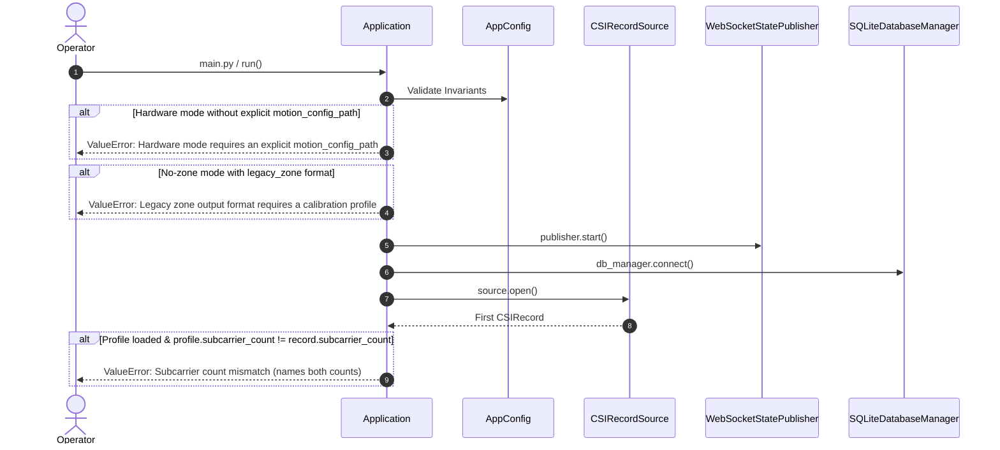
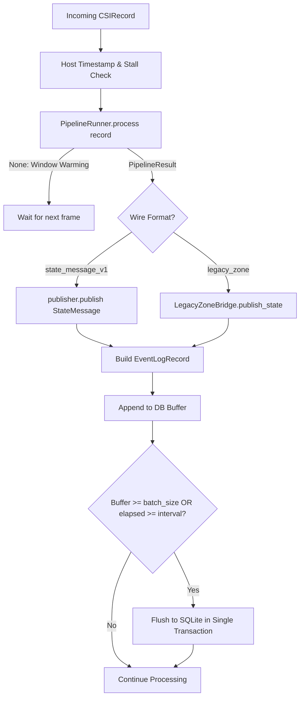
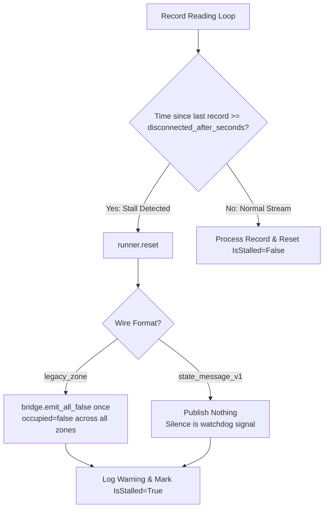
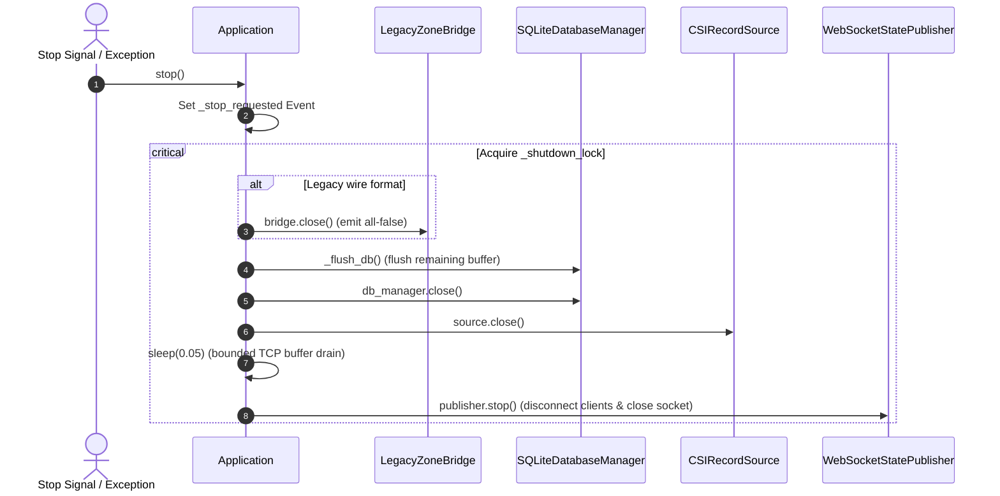

# Section 21 Architecture: End-to-End Application Wiring

This document specifies the end-to-end integration architecture for the WiSense Twin backend pipeline.
The application wires together frame ingestion, digital signal preprocessing, variance feature extraction,
threshold motion detection, zone classification, SQLite telemetry logging, WebSocket streaming (in both
`state_message_v1` and legacy Unreal format), and runtime health monitoring.

---

## 1. Architecture Overview

The system strictly decouples **Pipeline Orchestration** from **I/O and Networking**:
- **`PipelineRunner` (`wisense_backend.pipeline.pipeline_runner`)**: A pure, stateless algorithmic orchestrator. It processes one CSI frame at a time across Preprocessing -> Feature Extraction -> Motion Detection -> Classification, maintaining sequential correspondence by construction.
- **`Application` (`wisense_backend.app`)**: The I/O shell. It manages lifecycle, sources (`SyntheticCSISource` or `SerialCSISource`), publishers (`WebSocketStatePublisher` and optional `LegacyZoneBridge`), persistence (`SQLiteDatabaseManager`), health monitoring (`SystemHealthMonitor`), and graceful shutdown.

```mermaid
graph TD
    A[CSI Source<br/>Serial or Synthetic] -->|CSIRecord| B[Application Shell]
    B -->|process record| C[PipelineRunner]
    subgraph "Pure Algorithmic Core"
        C --> D[1. Preprocessing Pipeline<br/>Hampel + Moving Average]
        D --> E[2. Variance Feature Extractor<br/>Sliding Window W=20]
        E --> F[3. Threshold Motion Detector<br/>Dual-Threshold Hysteresis]
        F --> G[4. Zone Classifier (Optional)<br/>Nearest Euclidean Signature]
    end
    C -->|PipelineResult| B
    B -->|Publish First| H[WebSocket Publisher / LegacyZoneBridge]
    B -->|Buffer & Batch Insert| I[SQLite Database Manager]
    B -->|Periodic Telemetry| J[SystemHealthMonitor & Periodic Stats]
```

---

## 2. Startup & Fail-Fast Validation



### Hardware-Mode Requirements:
1. **Explicit Motion Config**: Hardware mode strictly forbids silently inheriting synthetic-scale default thresholds. `motion_config_path` must be explicitly configured.
2. **Matching Calibration Profile**: If a calibration profile is loaded, its subcarrier count must strictly match `record.subcarrier_count` on the very first incoming frame; otherwise startup raises immediately explaining that the profile must be re-calibrated on this physical hardware.
3. **No-Zone Mode (`calibration_profile_path=None`)**: The system runs purely as a motion/presence detector. In this mode, `zone_id`, `separation_margin`, and `calibration_version` are set to `None`. The legacy wire format (`legacy_zone`) is rejected at startup because legacy cubes require spatial zone indices.

---

## 3. Per-Record Data Flow & Decoupled Publishing

To protect publishing latency from disk I/O jitter, publishing occurs **strictly before** database logging.



### Latency Measurement Discipline:
- **`window_latency_ms`**: Physical latency floor imposed by the analysis window:
  $$\text{window\_latency\_ms} = \frac{W}{f_s} \times 1000\text{ ms}$$
  (e.g., $20 / 20\text{ Hz} \times 1000 = 1000.0\text{ ms}$).
- **`pipeline_latency_ms`**: Host computational delay from frame acquisition to write time ($t_{\text{host}} - t_{\text{record}}$). For non-realtime synthetic runs, this is strictly set to `None` to prevent recording meaningless synthetic clock offsets.

---

## 4. Stall & Gap Handling



### Why StateMessage v1 Publishes Nothing on Stall:
In the authoritative `state_message_v1` architecture, the downstream Unreal Engine 5 digital twin client incorporates an active stale-stream watchdog (Section 18). Silence on the wire is the authoritative indicator of a stalled or severed link; fabricating synthetic "idle" messages would mask link degradation.
Conversely, the legacy prototype Unreal cube visualizer lacks an internal watchdog; therefore, in `legacy_zone` mode, `LegacyZoneBridge.emit_all_false()` is explicitly triggered once upon stall to extinguish active visuals.

---

## 5. Shutdown Sequence

Shutdown is idempotent, thread-safe, and executed in a strict dependency order:



---

## 6. Manual Hardware Verification Guide

> [!NOTE]
> No physical hardware was attached during this implementation phase. The steps below document the verification procedure for operators connecting an ESP32 CSI receiver.

### Prerequisites:
1. ESP32 CSI receiver running firmware from Section 14 connected via USB (e.g., `COM4` or `/dev/ttyUSB0` at 921600 baud).
2. ESP32 transmitter running firmware from Section 13 active on the matched WiFi channel.

### Configuration (`config/system_config_hardware_example.json`):
```json
{
  "websocket_host": "127.0.0.1",
  "websocket_port": 8765,
  "database_path": "data/wisense_hardware.db",
  "log_level": "INFO",
  "log_format": "text",
  "csi_source_mode": "hardware",
  "synthetic_scenario_path": null,
  "serial_port": "COM4",
  "serial_baud_rate": 921600,
  "config_dir": "config",
  "calibration_profile_path": null,
  "motion_config_path": "config/motion_detection_config_hardware.json",
  "expected_sample_rate_hz": 20.0,
  "health_log_interval_seconds": 5.0,
  "stat_log_interval_seconds": 5.0,
  "db_flush_interval_seconds": 1.0,
  "db_flush_batch_size": 100
}
```

### Execution Command:
Run the application against the live serial stream for 30+ seconds in no-zone mode:
```bash
python backend_pipeline/main.py --config config/system_config_hardware_example.json
```

### Expected Output:
1. Startup logs confirm `run_id` format `hardware-<timestamp>-<hex>`, `csi_source_mode: hardware`, and `calibration_profile_path: None (no-zone mode)`.
2. Every 5 seconds, periodic stats report empirical subcarrier variances:
   ```
   Pipeline stats: variance [min=0.034120, mean=0.089450, max=0.215430], records=100, messages=81, source_errors=0, dropped_db_rows=0
   ```
3. Operators observe these baseline variance figures to empirically configure `enter_threshold` and `exit_threshold` in `config/motion_detection_config_hardware.json`.
